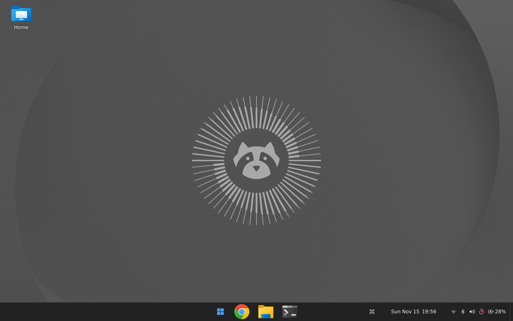
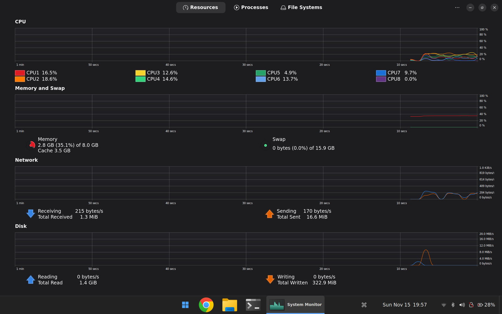
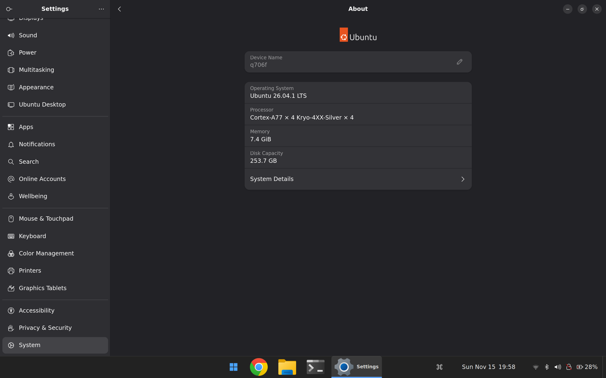
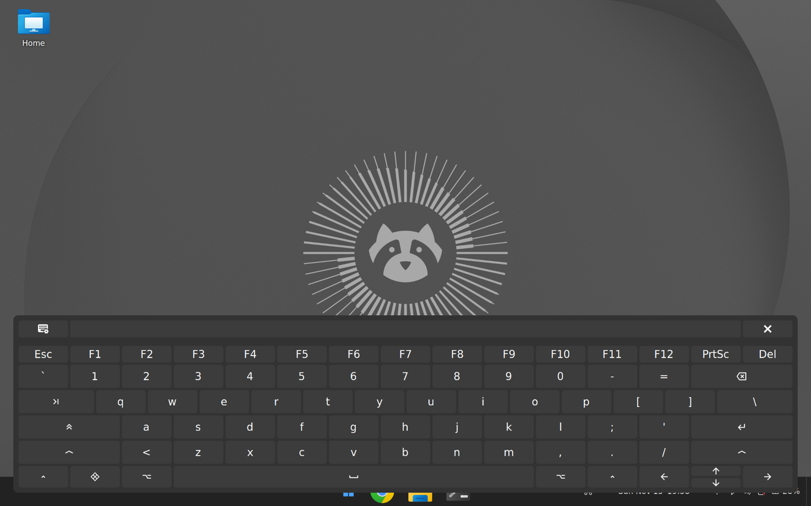

# Ubuntu 26.04 Desktop for the Lenovo Tab P12 Pro (TB-Q706F)

An unofficial, work-in-progress port of plain **Ubuntu 26.04 arm64 Desktop** (GNOME on
Wayland) to the **Lenovo Tab P12 Pro / Xiaoxin Pad Pro 12.6** (`TB-Q706F`, codename `q706f`,
Snapdragon 870 / SM8250, Adreno 650, 12.6" 2560×1600 AMOLED), running a **mainline Linux
kernel** instead of Android.

- **Stage: bring-up.** It runs as the author's daily test system on **one** tablet
  (8 GB / 256 GB, ROW), but it is not a finished product. Treat it as a developer preview.
- **Kernel:** upstream **Linux 7.3.4** (kernel.org tarball, sha256 pinned) plus the patch
  series in [`scripts/desktop/patches/`](scripts/desktop/patches/README) (13 patches: the
  q706f device support derived from silime's mainline tree, the project's own patches and
  three upstream fixes/backports).
- **Userland:** stock Ubuntu 26.04 (`resolute`) arm64 from `ports.ubuntu.com`, built with
  `mmdebstrap`, plus a small device overlay (udev rules, systemd units, helper scripts).
- **Boot:** the Lenovo ABL boots a header-v0 `boot.img` (Image.gz + appended mainline DTB +
  a small initramfs). The root filesystem is an ext4 **image file on `userdata`**
  (`/userdata/ubuntu-desktop.img`), loop-mounted by the initramfs. Android's `super` is not
  touched.

> **This can brick your tablet and it erases all data.** Unlocking the bootloader wipes the
> device, `install.sh` erases `dtbo_a` and writes `boot_a`, and the image changes A/B slot
> attributes in the GPT (see "Things the image does that you should know about").
> Take a full EDL backup first ([docs/RECUPERARE.md](docs/RECUPERARE.md)). You do all of
> this at your own risk.

The sibling project for Ubuntu Touch (Halium 11, Lenovo's 4.19 kernel) is
[ubuntu-touch-lenovo-q706f](https://github.com/stoicocimihaita/ubuntu-touch-lenovo-q706f);
it is no longer maintained.

## Screenshots

| | |
|---|---|
|  |  |
| GNOME desktop (dash-to-panel layout) | System Monitor: 8 cores, 8 GB RAM, zram swap |
|  |  |
| Settings → About | On-screen keyboard (GJS OSK) |

## Status

Tested between 2026-11-13 and 2026-11-15 on Linux 7.3.4. "Confirmed" means a person checked
the effect on the device; "SSH" means it was only verified with commands and logs.

| Component | State | Notes |
|---|---|---|
| Boot from `boot_a` / `boot_b` | ✅ | Unattended boot into GDM/GNOME; slot marked successful by a service (see below) |
| Display 2560×1600, 120/60 Hz | ✅ | DSI panel works; 60 Hz mode switch confirmed on 7.1, not re-checked on 7.3.4 |
| Brightness | 🟡 | Backlight control works; automatic brightness is off on purpose (fast changes can hang the panel) |
| GPU (Adreno 650) | ✅ | Freedreno/Turnip, GNOME accelerated, Vulkan works |
| Hardware video decoding | ❔ | `qcom_iris` binds; not tested |
| Touchscreen | ✅ | |
| Stylus (Precision Pen 3) on screen | ✅ | Pressure 0–4095, separate tablet device. **Needs `0113` (pending patch, see below)** to switch the digitizer into pen mode; tip/hover/tilt changes of `0109` not fully confirmed |
| Pen over Bluetooth, pen wireless charging (CTN730) | ✅ | Out-of-tree `ctn730` module; charging and battery level confirmed |
| Rotation / accelerometer, light sensor | ✅ / 🟡 | Through the SLPI sensor DSP: hexagonrpcd + libssc + patched iio-sensor-proxy (`setup-sensors.sh`) |
| Pogo keyboard / touchpad | 🟡 | Detected, tablet-mode switch implemented; typing and attach/detach not confirmed |
| On-screen keyboard | ✅ | GJS OSK in the session (`setup-gjs-osk.sh`, optional); GNOME OSK forced on the login screen (not confirmed physically) |
| Wi-Fi (QCA6390) | ✅ | 2.4 and 5 GHz; generic board data, regulatory domain from the timezone |
| Bluetooth | ✅ | BLE HID (the pen); BT audio not tested |
| Speakers (4× CS35L45) | 🟡 | Sound confirmed (L/R with 7.3.4). **No protection DSP:** volume is capped in UCM, see below |
| Microphones (WCD938x) | 🟡 | Recording works on 7.1; on 7.3.4 the source is present, quality not judged. Far-field AS33970 array disabled on purpose |
| Cameras (OV13B10, S5K5E9, OV8856) | 🟡 | All three in libcamera/PipeWire with a software ISP; dark image (no tuning), manual focus only (`0114`, pending) |
| Power button, cover (hall sensor) | ✅ | Both wake the tablet from s2idle |
| Volume buttons, vibration, flashlight | ❔ | Not tested / LED not exposed |
| Battery gauge | ✅ | bq27541: level, voltage, current, temperature; charge limit 4.25 V |
| Charging | 🟡 | **No 45 W fast charging** (the SMB1396 charge pumps have no mainline driver): 5 V only, about 1.5 A from a wall charger, 500 mA from a PC port. Thermal charging limits are implemented (`0110`) but were not tested hot |
| Suspend (s2idle) | 🟡 | Enter/wake works (power button, cover). **The SoC never reaches deep sleep** (CX/AOSS/DDR collapse counters stay 0): about 45–110 mA in suspend, ~2 days on a full battery. Root cause not found |
| USB gadget (NCM + SSH) | ✅ | Fixed address `172.16.42.1` for development and recovery |
| USB OTG, DisplayPort alt mode, microSD, USB-C audio | ❔ | Not tested |
| Fingerprint reader (Goodix, in QSEE) | ❌ | Experimental QSEECOM TEE series in `scripts/desktop/patches-fp/`; not part of the normal build |
| RTC | 🟡 | PMIC RTC is read-only; the clock is restored at boot (fake-hwclock) and by NTP |
| GPS / modem | ➖ | Wi-Fi-only model |
| `scripts/desktop/install.sh` | ❔ | **Never run end-to-end on a tablet** (only `--dry-run` and against a simulated initramfs). The author's tablet was installed by hand, step by step |

Known issues and limits:

- **Speakers have no protection.** On mainline the CS35L45 DACs are fed straight from the
  TDM bus; the Cirrus protection firmware (excursion/thermal limiting) is not in the path.
  The UCM profile pins `Digital PCM Volume` to 350 (−14.75 dB) on every amplifier. Do not
  raise it.
- **Deep sleep does not work** (see above). Several causes were ruled out (interconnect
  votes, DSPs stopped, PCIe link, LPASS votes); the remaining blocker is not visible from
  Linux yet. Details: `docs/DE-FACUT.md` section C (Romanian).
- **Default password.** The image has one account, user `ubuntu`, password `ubuntu`
  (unless built with `USER_PASSWORD=...`), and SSH password login is enabled. Change it at
  the first boot (`install.sh post` offers to). `scripts/desktop/tools/q706f-secure.sh`
  helps with key-only SSH, screen lock and sudo policy.
- The Lenovo bootloader's fastboot is flaky: it sometimes answers only every other command
  or refuses transfers after entering it from a running system. The scripts wait for six
  consistent answers before sending anything; `fastboot reboot bootloader` usually helps.
- After a failed `fastboot boot` the ABL marks the active slot unbootable and switches
  slots; recover with `fastboot set_active a`.
- Two complete hangs with an unknown cause were seen; the hardware watchdog and pstore are
  enabled to catch the next one.
- `apt install` only with `--no-install-recommends`: `hexagonrpcd` recommends
  `droid-juicer`, which pulls in `qbootctl` (rewrites A/B flags) and reboots the tablet.
  The overlay pins those packages to priority −1.

## What is in the kernel series

`scripts/desktop/build-kernel.sh` applies only `scripts/desktop/patches/*.patch`, in file-name
order, with zero fuzz:

- `0001`, `0201`, `0202`: upstream commits (v7.4-rc1) with their original headers.
- `0002`: the q706f device support (board DTS, panel, charger/fuel gauge, audio, cameras,
  pogo HID quirks, …), most of it from **silime's** mainline tree, re-applied on 7.3.4.
- `0101`: stylus support for `goodix_berlin` by **Pengyu Luo** (v2, not merged upstream).
- `0102`–`0111`: this project's patches (stylus/audio DTS, CTN730 node, pogo
  `SW_TABLET_MODE`, panel refresh rate, charge limits and charger input current/thermal
  limits, stylus tip/hover/tilt, AS33970 without firmware download).

Two other kinds of files sit next to them and are **not** applied:

- `*.pending`: prepared patches not yet integrated. The kernel the author actually runs is
  the series plus `0113` (pen-mode command, needed for the pen), `0114` (rear camera focus
  motor), `0203a–e` (upstream RFT "drm/msm: Attach a driver to GMU"), `0204`–`0206`
  (sleep-related clock/PCIe/interconnect changes) and the two proposals `0014`/`0015`,
  booted without `clk_ignore_unused pd_ignore_unused`. To build the same, rename those files
  to `.patch`. `0112` and `0115` are untested.
- `*.needs-approval`: proposals only (RTC offset in a PMIC SDAM cell, AS33970 capture link,
  Wi-Fi calibration variant, disabling unused QCE/PCIe2). Some write persistent state into
  chips; read each header first.

## Requirements

- A **TB-Q706F** with an unlocked bootloader. Developed on ROW stock firmware `S530352`
  (Android 13). The 5G model (TB-Q706Z) and other firmware versions are untested.
- An x86_64 Linux PC with Docker, `qemu-user-binfmt` (aarch64), `adb`/`fastboot`, `git`,
  `curl`, `patch`, about 60 GB free disk.
- The q706f firmware (GPU zap shader, DSP images, touch and amplifier firmware). It is
  proprietary and **not** in this repository; the scripts take it from a clone of
  [silime/lenovo-sm8250-q706f-firmware](https://github.com/silime/lenovo-sm8250-q706f-firmware)
  in `sources/` (or `$MAIN_REPO/sources/`).

## Build

```bash
git clone https://github.com/stoicocimihaita/ubuntu-desktop-lenovo-q706f
cd ubuntu-desktop-lenovo-q706f
git clone https://github.com/silime/lenovo-sm8250-q706f-firmware sources/lenovo-sm8250-q706f-firmware
scripts/setup-host.sh                    # builds the build container (scripts/docker)
scripts/desktop/check-host.sh            # one line per requirement
scripts/desktop/kernel-cycle.sh build    # kernel + ctn730 module + out/desktop/ubuntu-boot.img
scripts/desktop/make-testboot.sh        # diagnostic boot image (out/desktop/testboot.img) for install.sh
scripts/desktop/build-rootfs.sh          # Ubuntu 26.04 rootfs tree -> out/desktop/rootfs (~12 min)
scripts/desktop/make-rootimg.sh          # -> out/desktop/ubuntu-desktop.img (ext4, 14G)
scripts/desktop/check-rootimg.sh         # static checks of the image
```

`make-rootimg.sh` also downloads the ALSA UCM profile (see "Audio profile" below), so it
needs network access.

Nothing in the build touches the tablet. A full clean build from this repository has not
been run yet; the steps above are the ones the author uses, but report problems.

## Install

`scripts/desktop/install.sh` is a guided installer (see its header for every step). Run it
with `--dry-run` first and read what it would do. In short: check your own backup of
`boot_a`/`dtbo_a`, erase `dtbo_a` (the ABL applies the stock overlay to any DTB and refuses
the mainline one otherwise), boot a diagnostic initramfs from RAM, make sure `userdata` is
ext4 (formatting it **erases Android**), copy the rootfs image, boot Ubuntu from RAM, and
only then flash `boot_a`. Every write asks for a typed confirmation. Again: it has never been
run end-to-end on a real tablet.

Once Ubuntu runs: with USB connected, `ssh ubuntu@172.16.42.1`. The sensor stack
(`scripts/desktop/setup-sensors.sh`) builds libssc and iio-sensor-proxy on the tablet; it
needs the `hexagonfs/` files of the firmware repository.

## Things the image does that you should know about

- `q706f-mark-boot-successful.service` sets the "successful" bit (and the retry counter) of
  the running `boot_<slot>` entry in the GPT on every successful boot, keeping a backup of
  both GPT copies in `/var/lib/q706f/gpt-backups/`. Without it the ABL counts the slot's
  retries down and eventually refuses to boot it. This is a write to the partition table.
- The USB NCM gadget with SSH is always on.
- Bluetooth is switched off during suspend (`/etc/default/q706f-sleep`, `BT_OFF_IN_SLEEP`);
  the pen reconnects after wake-up.
- A thermal limiter (`q706f-thermal`) caps CPU/GPU frequencies from 70 °C.
- `q706f-flash-kernel` (manual tool, run on the tablet) writes a packaged boot image to
  `boot_a` after several checks; it is never run automatically.

## Audio profile (UCM)

The ALSA UCM profile for this tablet was written by **chalkin (silime)** for
[silime/ubuntu-lenovo-q706f](https://github.com/silime/ubuntu-lenovo-q706f). That repository
has no declared licence, so the files are **not redistributed here**.
`scripts/desktop/ucm/fetch-ucm.sh` (called by `make-rootimg.sh`) downloads them at a pinned
commit, checks their sha256 and applies
[`q706f-HiFi.conf.patch`](scripts/desktop/ucm/q706f-HiFi.conf.patch): the speaker volume cap
and the internal microphones. A WirePlumber rule in the overlay forces 16-bit PCM, without
which the amplifiers stay silent.

## Repository layout

| Path | Purpose |
|---|---|
| `scripts/setup-host.sh`, `scripts/dev-shell.sh`, `scripts/docker/` | Build container (Ubuntu 22.04, cross toolchain, mkbootimg) |
| `scripts/backup-edl.sh`, `scripts/edl.sh`, `scripts/docker-edl/` | Read-only full backup over Qualcomm EDL (bkerler/edl) |
| `scripts/desktop/build-kernel.sh`, `kernel-cycle.sh`, `make-testboot.sh`, `make-kernel-deb.sh` | Kernel, boot image, kernel package |
| `scripts/desktop/patches/` | Kernel series for Linux 7.3.4 (+ `.pending` / `.needs-approval`) |
| `scripts/desktop/*.config`, `config-pmos-q706f-6.11` | Kernel config: base from postmarketOS pmaports (`device-lenovo-q706f`) + fragments |
| `scripts/desktop/build-rootfs.sh`, `rootfs-customize.sh`, `make-rootimg.sh`, `check-rootimg.sh` | Root filesystem and image |
| `scripts/desktop/overlay/` | Device files copied into the image (mirror of `/`) |
| `scripts/desktop/ucm/` | Build-time download + patch of the UCM profile |
| `scripts/desktop/modules/ctn730/` | Out-of-tree driver for the NXP CTN730 pen charger |
| `scripts/desktop/sensors/`, `setup-sensors.sh` | iio-sensor-proxy patches, SLPI sensor setup |
| `scripts/desktop/libcamera/` | libcamera sensor helpers for the three cameras |
| `scripts/desktop/patches-fp/` | Experimental fingerprint (QSEECOM TEE + Goodix SPI) series, separate test kernel |
| `scripts/desktop/install.sh`, `initramfs-init`, `tools/` | Installer, bring-up initramfs, self-test, backup, security helpers |
| `scripts/desktop/setup-*.sh`, `win11-look/` | Optional: on-screen keyboard, Wi-Fi board data, a Windows-like GNOME layout |
| `docs/` | Status matrix, to-do list, kernel notes, driver map, rootfs reproduction, recovery |

The documents in `docs/` are in **Romanian** (the project's working language); code,
comments and commit messages are in English. Some documents are snapshots from
2026-11-13 and partly describe the earlier 7.1 kernel.

## Credits

- **silime (chalkin)** for the mainline q706f kernel work this port is built on
  ([silime/linux](https://github.com/silime/linux)), the UCM profile, the firmware
  collection and the reference Ubuntu/Deepin/Arch images for this tablet.
- **Pengyu Luo** for the `goodix_berlin` stylus support patch.
- The **postmarketOS** project and the Nura contributors for the device page, the
  `device-lenovo-q706f` kernel config and hardware documentation.
- **Lenovo** for the GPL kernel source release of the TB-Q706F (reference for the CTN730
  driver, the pen-mode command, the charger and the camera focus motor).
- **libssc** (Dylan Van Assche), **hexagonrpcd**, **iio-sensor-proxy** for the sensor stack.
- **GJS OSK** (vishram1123) for the on-screen keyboard extension.
- Dawid Wróbel for the QSEECOM TEE and Goodix SPI fingerprint series, Akhil P Oommen for
  the GMU series, and the authors of the upstream patches carried here (named in each
  patch header).

## License

The scripts, overlay and documentation in this repository are licensed under the GNU
General Public License v3.0 (see [LICENSE](LICENSE)). The kernel patches and the kernel
modules are GPL-2.0, as stated in their SPDX lines and patch headers; patches for other
projects (iio-sensor-proxy, libcamera) follow the licence of the project they patch.
Files taken from other projects keep their original licences and authors. No firmware or
other proprietary files are included.
